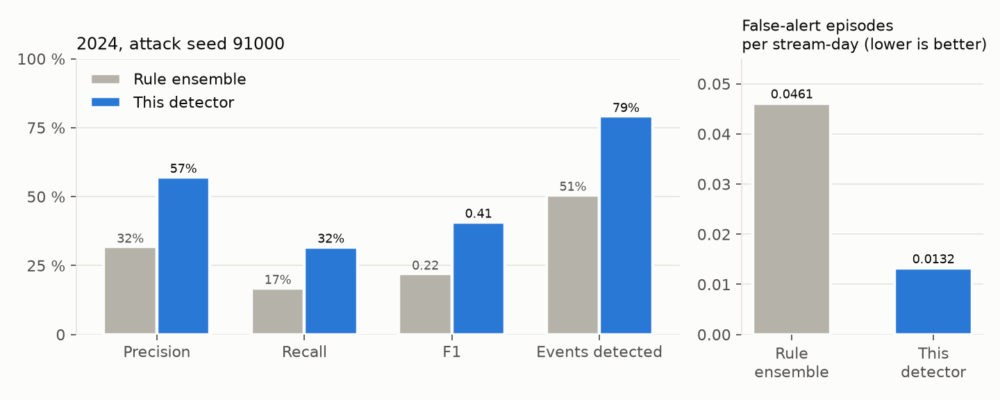
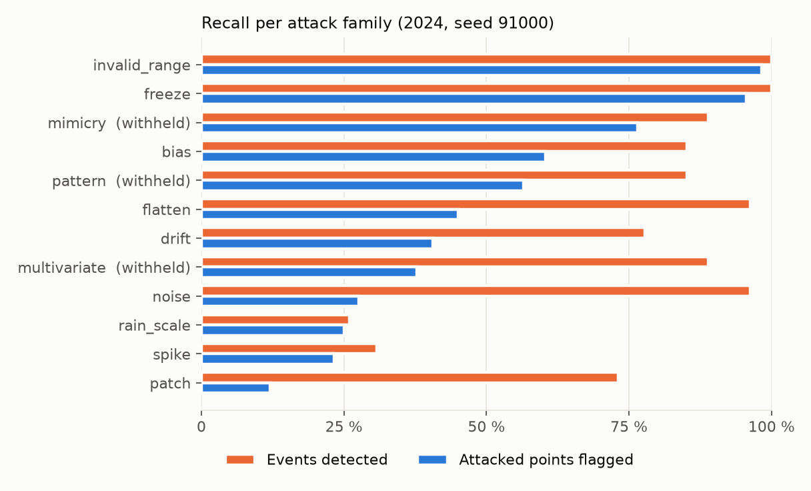
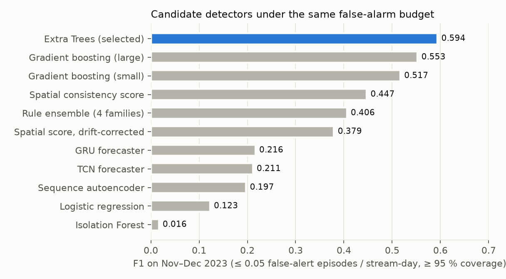

# Layer 3 – False-Data Injection Detector (TSYP14, Track 2)

**Layer 3** of the team's solution to the TSYP14 challenge *"Ground Truth Under Attack: Securing the Earth
Observation Chain"*, Track 2: False-Data Injection.

A digital signature proves *who* sent a weather reading, not that the reading is *true*. If a station or its
credentials are compromised, false values arrive correctly signed and pass every provenance check. Layer 3 closes
this gap. It checks every temperature, humidity and rain reading against its own history, its neighbours and
physics, and a trained classifier decides whether the reading looks manipulated. For every reading and every
30 minutes it returns a **calibrated anomaly value and an alert decision** to Layer 4, which manages trust and
quarantine.

**Results in one paragraph.** On a full year (2024) of real WegenerNet data with synthetic attacks, the detector
raises an alert on **79–82 % of attacks** (at least one alert during the attack) and flags **32–35 % of the
individual manipulated readings**; the median delay to the first alert was 60–90 minutes in the evaluation run
(slow drifts: about 10 hours). **57–60 % of its alerts are
real attacks**, and on clean data it raises **0.013 false-alert episodes per stream per day** (about one per
stream every 2.5 months). Against a transparent rule ensemble built from the same signals, it **doubles F1
(0.22 → 0.41)** and produces **3.5× fewer false alarms**. It runs on a laptop CPU.

---

## Contents

1. [Quick start](#1-quick-start)
2. [Architecture](#2-architecture)
3. [The detector, component by component](#3-the-detector-component-by-component)
4. [Data, attacks and protocol](#4-data-attacks-and-protocol)
5. [Results](#5-results)
6. [Why each design choice](#6-why-each-design-choice)
7. [Using the detector](#7-using-the-detector)
8. [Project structure](#8-project-structure)
9. [Scope and limitations](#9-scope-and-limitations)

---

## 1. Quick start

From the repository root:

```bash
python3 -m venv .venv
.venv/bin/python -m pip install --require-hashes -r requirements.txt
.venv/bin/python -m pip install -r requirements-detector.txt
.venv/bin/python -m pytest -q core/tests/test_detector.py   # 19 tests, no data needed
```

Unzip the WegenerNet NetCDF archives into `data/` so that `data/WN_L2_HHD_v8_2025_1_UTM_TF1_UTC_2023/` and
`…_2024/` hold the monthly `.nc` files, then:

```bash
.venv/bin/python -m core.detection.pipeline               # full pipeline
.venv/bin/python -m core.detection.pipeline --stage evaluate    # one step (stages: extract, features, train, calibrate, select, evaluate)
.venv/bin/python -m core.detection.pipeline --force       # rebuild everything
```

[`detector_walkthrough.ipynb`](detector_walkthrough.ipynb) runs the same steps one by one, with an explanation
before every cell. Everything runs on a CPU; there is no GPU, cloud service or paid API.

---

## 2. Architecture

```
            ┌──────────── causal features (37 per reading, past and present only) ────────────┐
reading ──► │  TEMPORAL        SPATIAL            PHYSICAL RULES       CONTEXT                │
(t, site,   │  forecast &      near & wider       range, rate,         time of day/year,      │
 variable)  │  seasonal        neighbour rings    freeze, variability  rain, quality flag     │
            │  residuals,CUSUM                                                                │
            └───────────────────────────────────────┬─────────────────────────────────────────┘
                                                    ▼
                         AI: Extra Trees classifier (one per variable) → attack score
                                                    ▼
                     calibration against clean data → tail value p (small = unusual)
                                                    ▼
                alert rule per variable: p ≤ alpha (+ two-of-three confirmation for humidity)
                                                    ▼
                                 Layer 4: p-value + alert for every reading
```

| Pipeline step | What happens | Data |
|---|---|---|
| `extract` | NetCDF → compact cache of 162 sites × 3 variables (486 streams), units and time convention checked | 2023–2024 |
| `features` | Learn the frozen normalisation of all causal features from clean data | Jan–Aug 2023 |
| `train` | Train one Extra Trees model per variable on clean and synthetically attacked data | Jan–Aug 2023 |
| `calibrate` | Store the score distribution on clean data | Sep–Oct 2023 |
| `select` | Choose the alert rule per variable under a false-alarm budget, then freeze it with artifact hashes | Nov–Dec 2023 |
| `evaluate` | Score the frozen detector on clean 2024 and on two independent attack seeds | 2024 |

---

## 3. The detector, component by component

All settings live in [`config/detector.yaml`](../../config/detector.yaml). Every feature at time *t* uses only values up to *t*, so the
detector can run live; [`core/tests/`](../tests/test_detector.py) checks that changing future values never changes earlier
features. Rain is modelled as `log(1 + mm)` so heavy showers do not dominate. All scales are **robust** (median and
1.4826 × MAD), learned per site and variable on clean training data.

### 3.1 Temporal component: does the reading fit its own past?

| Signal | Definition |
|---|---|
| Forecast residual `z_forecast` | Reading minus a forecast `b·x[t−1] + (1−b)·x[t−48]` (last value vs. same time yesterday), divided by the robust scale. The blend *b* ∈ {1, 0.75, 0.5, 0} is chosen per variable by error on the last quarter of the training data. |
| Seasonal residual `z_anchor` | Reading minus a per-site harmonic model of time of day and day of year (ridge regression). |
| CUSUM | Two-sided cumulative sum of the seasonal residual (allowance 0.5, cap 50). It accumulates small, persistent deviations into a strong signal, which is how slow **drifts** are caught. |
| History statistics | Step change, strictly-past median and MAD over 6 and 48 steps (3 h and 24 h), standard deviation, slope. |

Temporal score = max(|forecast residual|, CUSUM / its clean 95th percentile).

### 3.2 Spatial component: does the reading agree with its neighbours?

Weather is spatially smooth; a manipulated site disagrees with the sites around it.

| Signal | Definition |
|---|---|
| Two neighbour rings | **Near ring**: the 6 closest sites. **Wider ring**: the 19th–24th closest sites, which do not overlap the near ring. |
| Reference value | Weighted median of the valid, unflagged neighbours, weights ∝ 1/distance and **capped at 45 %**. At least 3 valid neighbours are required, otherwise the value is missing. |
| Residuals | Reading minus reference minus the site's usual offset, divided by its robust scale, for each ring. Also: neighbour spread and count, change of the neighbours vs. change of the target, residual relative to neighbour spread, and the residual's strictly-past mean and median (separates a sudden manipulation from a site's persistent local climate). |

Spatial score = max(|near residual|, |wider residual|).

### 3.3 Physical-rule component: is the reading physically plausible?

| Rule | Definition |
|---|---|
| Range | Humidity outside 0–100 % or negative rain (beyond numeric tolerance): a hard violation. |
| Rate | \|change\| relative to the clean 99th percentile of changes. |
| Freeze | Length of the current run of unchanged values relative to the clean 99th percentile. Dry rain and saturated humidity (~100 %) are exempt because they legitimately stay constant. |
| Variability | 6-step standard deviation relative to its clean 99th percentile. |

Physics score = the largest of the four.

### 3.4 AI component: Extra Trees classifier

The three family scores and all their underlying signals form **37 features per reading**:

| Group | Count | Features |
|---|---:|---|
| Temporal | 11 | forecast and seasonal residuals, temporal score, step change, 6/48-step median, MAD, standard deviation, slope |
| Spatial | 14 | near and wider residuals, spatial score, neighbour count and spread, past mean/median of the residual, neighbour change, target-minus-neighbour change, residual relative to spread |
| Physical rules | 4 | physics score, range excess, unchanged run, variability ratio |
| Context | 8 | hour and day-of-year (sin/cos), rain occurrence and amount, current value, quality flag |

**One Extra Trees classifier per variable** (120 trees, depth ≤ 18, ≥ 8 samples per leaf, 80 % of features per split)
learns which combinations of these signals indicate manipulation. Missing inputs (e.g. no valid neighbours) are
handled explicitly with missing-value indicators. The output is the probability that the reading was attacked.

**Training data** (Jan–Aug 2023). Each 14-day episode is replayed clean and with 4 independently seeded attacked
copies. Per episode and variable, up to 1,800 attacked readings and 1,800 clean readings are sampled; a quarter of
the clean ones are *hard* cases (the largest spatial residuals, i.e. real weather that looks suspicious).

| | Temperature | Humidity | Rain |
|---|---:|---:|---:|
| Training rows | 295,828 | 289,363 | 258,736 |
| of which attacked | 37,692 | 31,278 | 773 |

### 3.5 Calibration: from score to a comparable value

The model score is compared with the scores of clean Sep–Oct 2023 data (415,910 / 375,671 / 427,319 clean readings
for temperature / humidity / rain):

`p = (1 + number of clean scores ≥ this score) / (n + 1)`

A small *p* means "rarer than almost all clean data". The same *p* means the same thing for every variable, so one
false-alarm budget can be enforced across all three. Ties are counted conservatively.

### 3.6 Alert rule: when to raise an alert

For each variable the detector alerts when `p ≤ alpha`, either **directly** or with **two-of-three confirmation**:
the current reading and at least one of the two previous readings must exceed alpha. Confirmation suppresses
isolated false alarms and never back-dates an alert.

The rule is chosen on Nov–Dec 2023 from 9 alpha levels × 2 confirmation modes, per variable. The selection
criterion is the **best F1 that keeps clean-data false alarms ≤ 0.05 episodes per stream-day with ≥ 95 % of
readings scored**. The chosen rule is then frozen together with the SHA-256 hashes of every model file.

| Variable | Confirmation | alpha | Precision | Recall | F1 | False-alert episodes / stream-day |
|---|---|---:|---:|---:|---:|---:|
| Temperature | direct | 0.003 | 87.1 % | 50.7 % | 0.641 | 0.0049 |
| Relative humidity | two-of-three | 0.001 | 82.6 % | 50.4 % | 0.626 | 0.0110 |
| Rain | direct | 0.0003 | 100 % | 24.6 % | 0.395 | 0.0000 |

*Selection period Nov–Dec 2023; full search in [`results/threshold_search_2023.csv`](../results/threshold_search_2023.csv).*

---

## 4. Data, attacks and protocol

**Data.** WegenerNet Level 2 v8.0 (2025.1), Feldbach region, Austria: 24 monthly NetCDF files, January 2023 –
December 2024, every 30 min, UTC, 100 m grid. A regular 1.5 km sub-grid is kept, using only cells whose three
variables are clean for ≥ 95 % of the training period. That gives **162 sites × 3 variables = 486 streams**.
Temperature is converted from kelvin; quality flags mark interpolated or flagged values.

**Strict chronological protocol.** Each period is used for one purpose only, and nothing is tuned on the
evaluation year.

| Period | Purpose |
|---|---|
| Jan–Aug 2023 | fit features, train the models |
| Sep–Oct 2023 | calibration (clean data only) |
| Nov–Dec 2023 | choose and freeze the alert rule |
| **2024** | **evaluation only** (clean + two attack seeds) |

Replays use 14-day episodes; the first 24 h of each are warm-up and never alert.

**12 synthetic attack families**, generated reproducibly by [`core/detection/attacks.py`](../detection/attacks.py) and
injected *before* feature extraction (the detector only sees the manipulated values). Labels mark only readings
whose value actually changed.

| Family | Manipulation | Family | Manipulation |
|---|---|---|---|
| bias | constant offset | rain_scale | rain ×0, ×0.5 or ×2 while raining |
| drift | offset ramping up from zero | pattern* | offset following a daily cycle |
| spike | 1–4-step offset | mimicry* | plausible random series with realistic mean/variance |
| freeze | last value repeated | patch | same offset on all sites within 1.5, 3 or 6 km |
| noise | added random noise | multivariate* | temperature and humidity shifted together, consistently |
| flatten | variability suppressed | invalid_range | humidity outside 0–100 % |

\* **Withheld from training**: these families appear only in selection and evaluation, so their results measure
how well the detector generalises to unseen attack types. Attack windows last 6, 24 or 48 h. Amplitudes in 2024 are
**different from training** (±0.75–3 °C, ±7.5–15 % humidity, vs. ±0.5–4 °C and ±5–20 % in training). The two 2024
seeds place attacks at different sites and times.

More detail (threat model, quality flags, metric definitions):
[`core/docs/data_and_threat_model.md`](data_and_threat_model.md).

---

## 5. Results

All metrics are **strict point metrics with no point-adjustment**: every attacked reading that is not flagged
counts as a miss, and a reading that cannot be scored also counts as a miss.

### 5.1 Overall (2024, frozen detector)

| | Precision | Recall (readings) | F1 | Attacks detected (events) | Median delay to first alert | False-alert episodes / stream-day |
|---|---:|---:|---:|---:|---:|---:|
| Attack seed 91000 | 57.1 % | 31.8 % | 0.408 | 79.2 % | 60 min | 0.0132 |
| Attack seed 191000 | 59.6 % | 35.3 % | 0.443 | 82.2 % | 90 min | 0.0132 |

The two independent seeds give consistent results. Coverage is 100 %: every eligible reading is scored. Per
variable (seed 91000): temperature precision 46.9 % / recall 24.2 %; humidity 71.1 % / 43.0 %; rain 25.2 % / 25.1 %.

### 5.2 Against a rule-based detector built from the same signals

The **rule ensemble** fuses the temporal, spatial and physics scores and an Isolation Forest with a
Bonferroni-corrected minimum p-value. It is the natural non-learned alternative, evaluated on the same 2024 data.



| 2024 | Rule ensemble | This detector | Change |
|---|---:|---:|---:|
| Precision (seed 91000 / 191000) | 31.8 % / 31.8 % | 57.1 % / 59.6 % | ≈ 1.8× |
| Recall | 16.8 % / 18.0 % | 31.8 % / 35.3 % | ≈ 1.9× |
| F1 | 0.220 / 0.230 | 0.408 / 0.443 | ≈ 1.9× |
| Attacks detected | 50.6 % / 54.5 % | 79.2 % / 82.2 % | +29 points |
| False-alert episodes / stream-day | 0.0461 | 0.0132 | 3.5× fewer |

*Source: [`results/detector_vs_rule_ensemble_2024.csv`](../results/detector_vs_rule_ensemble_2024.csv).*

### 5.3 Per attack family



- **Caught almost always:** invalid range (98 % of readings, 100 % of attacks) and freeze (96 % / 100 %), through
  the physical rules.
- **Unseen families generalise:** mimicry 77 % of readings / 89 % of attacks, pattern 57 % / 85 %, and
  multivariate 38 % / 89 %, although none of the three was in the training data.
- **Detected as events, partly as readings:** noise (96 % of attacks), flatten (96 %), bias (85 %) and drift (78 %).
  The detector finds the attack, but not every manipulated reading inside it. For drift this is because the first
  readings of a ramp are almost unchanged.
- **Hard:** spikes (23 %), rain scaling (25 %) and wide patches (12 % of readings, although 73 % of patch attacks
  are still detected). See [§ 9](#9-scope-and-limitations).

Median delay to the first alert (seed 91000): spike and multivariate 0 min, bias and invalid range 30 min,
freeze 60 min, patch 120 min, drift 600 min (a slow ramp is small at first by design).

### 5.4 Cost

Under **3 s per 14-day episode for all 486 streams** on 4 CPU threads, i.e. far faster than real time (one new
reading per stream every 30 minutes). Each run records its timing in `outputs/metrics.json`.

---

## 6. Why each design choice

| Choice | Justification | Evidence |
|---|---|---|
| **Learned classifier on top of the rule signals** | Each rule sees one aspect. The classifier learns how they combine, e.g. "deviates from the past *but* neighbours moved too" is weather, not an attack. | F1 0.22 → 0.41, false alarms 3.5× lower than the rule ensemble on the same signals (§ 5.2) |
| **Extra Trees rather than other models** | Strongest of 11 candidates under the same false-alarm budget. Fast on CPU, robust to irrelevant features, handles missing inputs, and its randomised splits limit over-fitting to synthetic attacks. | Figure below; [`results/model_comparison_2023.csv`](../results/model_comparison_2023.csv) |
| **Temporal + spatial + physical features together** | They catch different attacks: rules catch range and freeze, temporal signals catch drift and spikes, spatial signals catch offsets invisible in a single series. | Per-family recall (§ 5.3) |
| **Two disjoint neighbour rings, weights capped at 45 %** | A coordinated attack on nearby sites can fool the near ring; the wider ring is an independent check. The cap stops one neighbour (possibly attacked) from dominating the reference. | Patch attacks: 73 % detected as events, although they corrupt the near neighbours |
| **CUSUM on the seasonal residual** | Slow drifts never produce a single large step; accumulating small deviations exposes them. | Drift: 78 % of attacks detected |
| **Freeze exemptions for dry rain and saturated humidity** | About 90 % of rain intervals are dry, and humidity often sits at 100 %; without exemptions these legitimate constant runs would raise constant false alarms. | Verified by unit test (`test_dry_rain_and_saturated_humidity_are_not_freeze_evidence`) |
| **Hard clean examples in training** | Teaches the model that real local weather (large but genuine neighbour differences) is *not* an attack, which is where neighbour-based detectors produce most false alarms. | Part of the training design behind the 0.013 false-alarm rate (not separately ablated) |
| **Three attack families withheld from training** | Tests generalisation to attack types the model has never seen, which is the realistic situation. | Mimicry 89 %, pattern 85 %, multivariate 89 % of attacks detected |
| **Calibration on separate clean data** | Turns arbitrary scores into comparable tail values, so one false-alarm budget applies to all variables, and the budget is set on data the model was not trained on. | Measured 2024 false-alarm rate (0.013) stays within the 0.05 budget |
| **Per-variable alert rules** | The variables behave differently: rain is rarely attacked-and-observable, humidity is noisy. One shared threshold over-alerts on rain. | Rain precision 8.6 % → 25.2 % (seed 91000), spike recall 15 % → 23 %, overall F1 unchanged (0.402 → 0.408); [`results/ablation_alert_rule_2024.csv`](../results/ablation_alert_rule_2024.csv) |
| **Two-of-three confirmation for humidity** | Humidity fluctuates more; requiring a second exceedance within an hour removes isolated false alarms. | Chosen by the selection criterion (§ 3.6) |
| **False-alarm budget 0.05 episodes / stream-day** | An operator sees at most one false episode per stream every 20 days; the measured rate is ~4× lower. | § 5.1 |
| **Strict chronological splits, frozen with hashes** | No information from the evaluation year leaks into training, calibration or threshold choice; the frozen files cannot change silently. | `Detector` and `evaluate` verify SHA-256 hashes before scoring |
| **Strict point metrics, no point-adjustment** | Point-adjusted scores overstate performance (one hit would count a whole attack as caught). Reporting both readings and events shows the true picture. | § 5 |



*Candidates compared on Nov–Dec 2023 under the same budget. The gradient-boosting models came close. The neural
models (GRU and TCN forecasters, a sequence autoencoder) are trained only on clean data and react to anything
unusual, so under a strict false-alarm budget they recall few attacks. Isolation Forest alone cannot separate
attacks from rare weather.*

---

## 7. Using the detector

```python
from core.detection.model import Detector
from core.detection.data import load_partition, episodes

_, episode = next(episodes(load_partition("validation")))   # values [time, 162 sites, 3 variables], 30-min UTC
p, alerts = Detector()(episode)                             # p-values and boolean alerts, same shape
```

`Detector()` loads the frozen artifacts from `artifacts/` and refuses to run if any file's hash has changed.
`p` is what Layer 4 uses to grade trust; `alerts` is the binary decision. The first 48 steps (24 h) of each
episode are warm-up.

---

## 8. Project structure

The detector lives inside the main repository (paths from the repository root):

```
├── config/detector.yaml             all settings (data, features, attacks, model, alert rule, evaluation)
├── core/detection/
│   ├── data.py                      NetCDF → cache, chronological splits, 14-day episodes
│   ├── attacks.py                   the 12 seeded attack families and their labels
│   ├── features.py                  temporal, spatial and physical-rule features (37 per reading)
│   ├── model.py                     Extra Trees, calibration, alert rule, Detector (inference)
│   ├── metrics.py                   point / event metrics, false-alert episodes
│   ├── adapter.py                   Layer 2 FeatureWindows / compact CSV → detector input
│   ├── pipeline.py                  python -m core.detection.pipeline
│   └── utils.py
├── core/tests/test_detector.py      causality, leakage, missing data, attacks, calibration, metrics
├── core/results/                    the result tables cited in this README
├── core/docs/
│   ├── README.md                    this file
│   ├── detector_walkthrough.ipynb   the pipeline step by step, with explanations
│   ├── data_and_threat_model.md     dataset, threat model, attack families, metric definitions
│   ├── layer3_specification.docx
│   └── figures/                     README figures (make_figures.py regenerates them from core/results/)
└── requirements-detector.txt        detector dependencies (on top of requirements.txt)
```

The trained model is shipped in `artifacts/` at the repository root (feature extractor, models, calibration,
frozen `policy.json`); `--force` retrains it. A run creates two git-ignored folders: `data/cache/` (extracted
data) and `outputs/` (metrics, per-variable and per-family tables, `RESULTS.md`).

---

## 9. Scope and limitations

- **Layer 3 only.** Signatures, sequence and replay checks belong to Layer 1, and trust states, quarantine and
  imputation to Layer 4. The team's station attack suite and evasion sweep are in `attacks/` and `eval/`
  ([evaluation-suite.md](../../docs/evaluation-suite.md)). That suite uses 5-minute station data; this detector is
  trained on the half-hourly grid and must be retrained on station data before it can be graded there.
- **Synthetic attacks on gridded data.** Grid cells are interpolated, not independent sensors. The 2024 attacks
  use amplitudes not used in training (but inside its range), new placements and three unseen families, but come from the same generator as the training
  attacks. The 2024 figures are therefore strong evidence, not an independent benchmark.
- **Known weak spots.**
  - *Rain*: only 773 attacked rain rows are available for training, and scaling rain during dry periods changes
    nothing observable.
  - *Wide patches*: an attack covering a whole neighbourhood also corrupts the spatial reference. An external
    reference (satellite or reanalysis) is the natural fix.
  - *Single-reading spikes*: one reading gives little evidence.
- **Latency and memory** (`python -m eval.detector_overhead`): a live 30-minute tick for all 486 streams takes a
  median 0.2 s on a 2-core CPU; peak memory 0.85 GB ([docs/results.md](../../docs/results.md#detector-latency-and-memory)).
- An alert is evidence for investigation, not proof of an attack.

**Data:** WegenerNet Level 2 v8.0 (2025.1), Wegener Center, University of Graz,
DOI [10.25364/WEGC/WPS8.0-2025.1](https://doi.org/10.25364/WEGC/WPS8.0-2025.1), CC BY 4.0.
